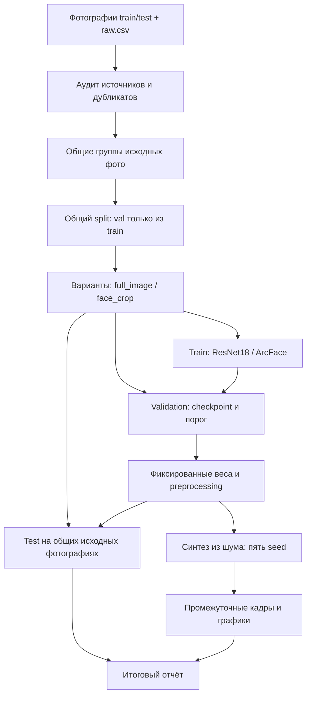

# Архитектура проекта «Как модель представляет Соколова»

## Зафиксированные решения

Две модели: **ResNet18 и ArcFace**. Два варианта датасета: **полный кадр
(`full_image`) и вырезанное лицо (`face_crop`)**. У каждого есть внешние train/test;
validation выделяется только из train. Один локальный Python-проект без сервера
и базы данных. Этапы обмениваются манифестами и файлами артефактов.

Статус: архитектура и каркас. CLI проверяет конфигурации; ML-стадии пока
представлены интерфейсами. Данных, обученных весов и измеренных метрик нет.

| Модель | Данные | Конфиг | Вход |
| --- | --- | --- | --- |
| ResNet18 / ImageNet | `full_image` | `configs/baseline.toml` | RGB 224 × 224 |
| ResNet18 / ImageNet | `face_crop` | `configs/resnet18_face.toml` | RGB 224 × 224 |
| ArcFace / iResNet50 / MS1MV3 | `face_crop` | `configs/arcface_face.toml` | RGB 112 × 112 |

ArcFace — функция потерь предобучения, а не единственная архитектура.
В проекте под этим именем фиксируем **iResNet50 из InsightFace arcface_torch,
предобученную на MS1MV3 с ArcFace**. Конкретный адаптер, ревизию исходников и
локальные веса ещё предстоит подключить. ArcFace на целом кадре не запускаем.

## Поток данных



## Границы компонентов

| Компонент | Вход | Ответственность / выход |
| --- | --- | --- |
| `data.prepare` | raw.csv и фотографии | Аудит, SHA-256, pHash, общие group_id |
| `data.split` | Полный исходный набор и group_id | Общие ParentAssignment до выделения лиц |
| `data.dataset` | Вариант, split, конфиг модели | Тензор, метка образца, связь с исходным фото |
| `model` | Конфиг ResNet18 / ArcFace | Модуль с одним логитом `[B, 1]` |
| `train` | Только train и val | Checkpoint, история, fingerprint данных |
| `evaluate` | Фиксированная модель и порог | Предсказания, метрики, ошибки |
| `synthesize` | Checkpoint, seed, ограничения | Кадры и траектория оптимизации пикселей |
| `visualize` | Сохранённые кадры и траектории | Сетки, графики, сравнение всех seed |

`config.py` проверяет допустимые сочетания моделей и данных. `contracts.py`
фиксирует типы артефактов. Импорт модулей не запускает обучение и не скачивает веса.
Визуализации читают сохранённые результаты без повторного обучения.

## Данные и отсутствие утечек

Исходная схема: `image_id,path,label,source_id,source_url,partition`.
Метка кадра: 1 — нужный Евгений Соколов присутствует; 0 — отсутствует.
Идентичность проверяем вручную по эталонным фотографиям до сбора данных.
`partition` строго train/test. Пути и правила — в `data/README.md`.

SHA-256 выявляет точные дубликаты. pHash после исправления EXIF-ориентации
находит кандидатов в похожие кадры: стартовый порог 6 бит для 64-битного хеша.
Это эвристика, а не гарантия; обрезки и републикации требуют аудита.
Общий source_id и подтверждённые дубликаты образуют рёбра графа; его связанные
компоненты становятся group_id. Учитываем транзитивные связи.

Если группа пересекает внешние train/test, подготовка останавливается до явного
исправления данных. Test не перераспределяем автоматически. Его размер определяется
предоставленным набором, а не желаемой пропорцией из конфига.

Внутри внешнего train выделяем приблизительно 20% в val, seed=42, с балансом
классов насколько позволяют группы. Например, выбираем целые фолды
StratifiedGroupKFold. Целостность групп важнее точного процента. При нехватке
групп или класса завершаем этап с объяснением, а не делим фотографии случайно.

Сохраняем общий ParentAssignment: `image_id,group_id,partition,split`, а также
хеш манифеста и seed. Только после этого строим оба варианта данных.
Все лица одного фото наследуют его split. Для разных моделей split не пересоздаём.

PreparedSample хранит ссылку на RawSample, собственные sample_id, variant, path,
label, хеши, group_id и split. В производном CSV связь с фото — parent_image_id.
Метка лица размечается отдельно: на положительном групповом фото другие люди
получают 0 после проверки. Не копируем положительную метку кадра всем лицам.

Face crops выделяем и выравниваем по пяти точкам один раз для обеих моделей,
затем масштабируем под их вход. Версия детектора, координаты и ключевые точки
сохраняются в метаданных; детектор и настройки фиксируются до test.
Случаи no_face и неуверенной разметки отражаем в аудите. Исходные test-фотографии
без успешно выделенных лиц нельзя молча исключать из итоговой оценки.

Перед обучением проверяем: обе метки в каждой части, отсутствие общих групп,
ID и дубликатов между split, совпадение parent assignments у обоих вариантов.
Отдельно показываем число исходных фото, лиц и независимых групп.
Аугментации создаются после split и только в train.

## ResNet18

`torchvision.models.resnet18`, веса `ResNet18_Weights.IMAGENET1K_V1`.
Заменяем последний слой на Linear(512, 1). RGB 224 × 224 → логит z → sigmoid(z).
Обучение использует BCEWithLogitsLoss напрямую от логита.

Для full_image сохраняем весь кадр: масштабирование с сохранением пропорций,
letterbox до 224, перевод в [0, 1], нормализация ImageNet:
mean=(0.485, 0.456, 0.406), std=(0.229, 0.224, 0.225).
Цвет дополнения — средний RGB ImageNet. Слепой crop может убрать человека и
испортить положительную метку, поэтому его не используем.
Для face_crop используем то же выделенное лицо, что ArcFace, с размером 224.

Обучаем голову 5 эпох, Adam lr=1e-3, затем последний блок и голову до 10 эпох,
lr=1e-4. Лучший checkpoint — по validation AP; early stopping реализуем при
обучении. Замороженным блокам фиксируем и статистики BatchNorm.

## ArcFace / iResNet50

Официальный PyTorch-backbone InsightFace arcface_torch: iresnet50 / MS1MV3.
Вход — выровненное лицо RGB 112 × 112, пиксели [0, 1], mean/std=(0.5, 0.5, 0.5).
Encoder → 512 признаков → L2-нормализация → Linear(512, 1).
Бинарная голова обучается с BCEWithLogitsLoss; ArcFace с нуля на двух классах
не обучаем. Первоначально encoder и его BatchNorm заморожены, обучается только
голова: 5 эпох, lr=1e-3, finetune_epochs=0. Возможное дообучение — отдельный запуск.

Ожидаемый файл: checkpoints/arcface/iresnet50_ms1mv3.pt. Веса не входят в Git
и не скачиваются проверкой конфига. При подключении фиксируем источник,
SHA-256 и ревизию кода; не игнорируем несовместимые слои при загрузке state_dict.
Условия предоставления исследовательских весов указаны в официальном model zoo.

Для синтеза требуется полный PyTorch-forward с градиентом по входу.
ONNX Runtime и detach в этом тракте не подходят. Кэш embeddings допустим
для отдельного обучения головы, но не заменяет encoder при синтезе.

## Обучение и проверка качества

Val/test детерминированы. Лёгкие train-аугментации: отражение и умеренное
изменение цвета. Параметры конфигов — исходные гипотезы, а не подобранные значения.
При дисбалансе pos_weight рассчитываем только по train-меткам текущего варианта.

Checkpoint сохраняет state_dict, архитектуру, вариант данных, preprocessing,
источник и SHA-256 весов, mapping меток, конфиг и fingerprint общего split.
Порог привязываем к этому checkpoint и выбираем по максимальному F1 на val.

Основные метрики: average precision (AP), ROC-AUC, precision/recall/F1,
confusion matrix, примеры FP/FN. Accuracy — только дополнительный показатель.
При оценке неопределённости bootstrap делаем по группам, а не по кадрам.
Не назначаем целевые проценты до аудита данных; sigmoid-оценка не считается
автоматически калиброванной вероятностью.

Сравниваем encoder на одинаковых face crops. Сравнение всего кадра и лицевой
системы проводим на одних исходных фотографиях: score фото — максимум score лиц;
no_face даёт отрицательное решение и отдельный флаг. Пропущенное лицо Соколова
на положительном фото учитывается как FN. На val выбираем checkpoint и порог
с той же агрегацией, по image-level AP/F1; crop-метрики показываем отдельно.
Показываем долю фото, на которых детектор нашёл лицо. Не сравниваем crop-F1
одной модели с image-F1 другой как равнозначные величины.

После выбора параметров фиксируем модели и оцениваем test. Если после просмотра
test меняем настройки, для новой независимой финальной проверки нужен новый holdout.

## Градиентная генерация из шума

Загружаем checkpoint, eval(), веса заморожены. Создаём равномерный шум x в [0, 1],
форма [1, 3, H, W]: 224 для ResNet18 и 112 для ArcFace. Оптимизатор Adam
меняет только пиксели: 500 шагов, lr=0.05. Минимизируем:

```text
loss(x) = -z(normalize(x)) + λ_tv · TV(x) + λ_l2 · mean((x - 0.5)²)
TV(x)   = mean(|x[:, :, 1:, :] - x[:, :, :-1, :]|)
        + mean(|x[:, :, :, 1:] - x[:, :, :, :-1]|)
λ_tv    = 1e-4
λ_l2    = 1e-5
```

После шага проецируем x в [0, 1]. Нормализация остаётся дифференцируемой.
Максимизируем логит: sigmoid насыщается. Для графика сохраняем оба значения,
а также TV, L2 и objective. Коэффициенты регуляризации предстоит проверить.

Нельзя оборачивать весь forward в torch.no_grad(): нужен градиент по входу.
Этот контекст допустим для проекции и отдельного измерения после шага.
Оценку сохранённого кадра вычисляем после проекции. Сохраняем шаг 0, каждые
25 шагов и финал. Для ArcFace синтезируем непосредственно входной face crop:
детектор/поиск ключевых точек не входит в цикл градиентной оптимизации.

Проверяем ненулевой конечный градиент по x, изменение пикселей, неизменность
весов, диапазон пикселей и соответствие оценок сохранённым кадрам.
Adam не гарантирует монотонного улучшения на каждом шаге.

Повторяем для seed 0, 1, 2, 3, 4. Внутри каждого сочетания модель/вариант
checkpoint и настройки одинаковы. Сохраняем все результаты, сетки шагов,
финалы и кривые. Разрешения моделей различаются и указываются в отчёте.
Уверенность на узоре не доказывает качество распознавания и не обязана давать лицо.

## Артефакты запуска

```text
outputs/runs/<model>/<variant>/<run_id>/
  config.toml
  environment.txt             версии библиотек и устройство
  provenance.json             commit, dirty status, SHA-256 весов и данных
  data_audit.json             похожие пары, crop-метаданные, no_face
  split.csv                   общий image_id → group_id → partition → split
  training.csv
  best.pt
  threshold.json
  test_metrics.json           image-level и crop-level отдельно
  test_predictions.csv        все исходные test image_id, включая no_face
  confusion_matrix.png
  synthesis/seed_<n>/
    trajectory.csv            step, logit, score, TV, L2, objective
    step_0000.png ... final.png
    progression.png
    scores.png
  seed_comparison.png
  report.md
```

Фотографии, реальные манифесты, веса и результаты запусков исключены из Git.
Код, схемы, параметры и документация версионируются. Артефакты передаются отдельно.

## Порядок реализации и готовность

| Этап | Проверяемый результат |
| --- | --- |
| 1. Аудит и общий split | Нет пересечений групп, train/test сохранены, val только из train |
| 2. Полный кадр и лицо | Общие parent assignments, проверенные crop-метки, no_face в аудите |
| 3. Две модели и обучение | Загружаемые checkpoint, SHA-256 исходных весов, train/val история |
| 4. Оценка | Val-порог, test на общих фото, image/crop метрики и ошибки |
| 5. Синтез и multi-seed | Пять траекторий на сочетание, неизменные веса, кадры и графики |

Сейчас проверены конфигурации и их допустимые сочетания. Будущие ML-проверки
утечек, градиентов, загрузки весов и качества ещё не запускались.

## Первичные источники

- [Torchvision ResNet18](https://docs.pytorch.org/vision/stable/models/generated/torchvision.models.resnet18.html).
- [ArcFace: исходная работа](https://arxiv.org/abs/1801.07698).
- [InsightFace: официальный arcface_torch и MS1MV3 / r50](https://github.com/deepinsight/insightface/tree/master/recognition/arcface_torch).
- [iResNet: реализация backbone](https://github.com/deepinsight/insightface/blob/master/recognition/arcface_torch/backbones/iresnet.py).
- [ArcFace: вход 112 и нормализация](https://github.com/deepinsight/insightface/blob/master/recognition/arcface_torch/inference.py).
- [StratifiedGroupKFold](https://scikit-learn.org/stable/modules/generated/sklearn.model_selection.StratifiedGroupKFold.html).

Выбор двух вариантов, split-протокол, бинарные головы и настройки синтеза —
проектные решения, качество которых предстоит проверить экспериментально.
