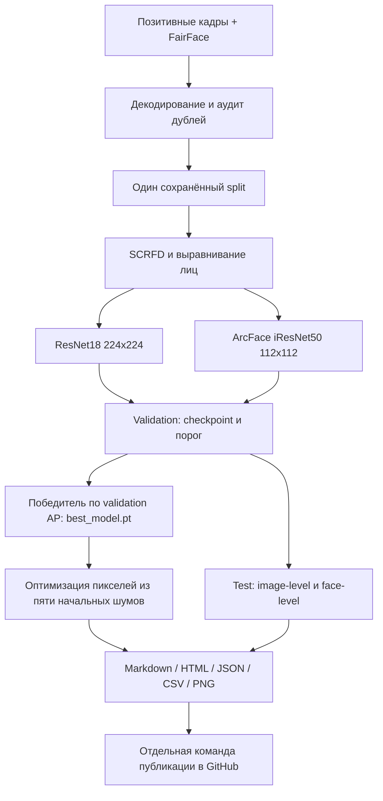

# Архитектура конвейера

## Поток

CLI `check-config` не импортирует ML-библиотеки. Остальные команды лениво подключают нужные модули. `run-all` проверяет исходные веса обеих моделей до загрузки FairFace и подготовки данных; общего обучения с нуля вместо предобученных весов не допускается.

## Данные

Конфигурации моделей разделяют параметры данных и split. Загрузчик FairFace фиксирует выбранную версию/файлы; подготовка проверяет хеши и сохраняет единый split на исходных image_id. В автоматическом режиме это random stratified 70/15/15, seed=42, с допустимым пересечением источников. Наборы с полными внешними train/test назначениями сохраняют test и делят train по группам для val.

Точные RGB-дубликаты удаляются до split, конфликтующие метки останавливают этап. pHash выводит кандидатов для аудита. В подготовке один SCRFD/алгоритм выравнивания применяется обоим классам. Единственное лицо сохраняется 224×224; исходники без единственного пригодного лица отражаются в манифесте и полном test. Для обучения нужны обе метки во всех частях.

Исходные/производные схемы и ограничения: `data/README.md`. Манифесты и изображения защищены отпечатками; несовместимые изменения требуют новых папок. Первоначальное разделение и детекция предшествуют всем аугментациям.

## Модели и обучение

ResNet18: torchvision IMAGENET1K_V1, RGB, ImageNet normalization, Linear(512,1). Голова 5 эпох Adam 1e-3, затем layer4 и голова до 10 эпох Adam 1e-4.

ArcFace: официальный PyTorch iResNet50/MS1MV3; исходник backbone закреплён ревизией в `src/sokolov/backbones/NOTICE.md`, лицензия сохранена рядом. RGB 112, normalization mean/std=.5, L2-normalized 512 embedding, Linear(512,1). Encoder заморожен, голова 5 эпох Adam 1e-3. Веса — внешний официальный checkpoint со строгим load_state_dict; URL-загрузка требует SHA-256. ONNX не заменяет обучаемый PyTorch-модуль.

Обе модели: BCEWithLogitsLoss, pos_weight=negative_train/positive_train, batch_size=32, weight_decay=1e-4. Train-аугментации: horizontal flip и ColorJitter .1. Замороженные поддеревья, включая BatchNorm, работают в eval. Validation/test детерминированы.

Checkpoint выбирается по image-level validation AP, ранний при равенстве. Порог — по image-level validation F1, больший при равенстве. Пропуски детектора получают score=0 и принудительное отрицательное решение даже при threshold=0.

Last checkpoint содержит модель, оптимизатор, эпоху/стадию, историю, RNG, данные/конфиг, provenance весов, окружение и время. Resume проверяет отпечатки; стадии и последовательность аугментаций воспроизводятся по seed/epoch. Best checkpoint фиксирует выбранную validation модель. Обучение не вызывает test-предсказания.

## Оценка и отчёт

Test запускается после завершения обучения. Image-level включает все исходники test; face-level — успешно выделенные лица. Метрики: ROC-AUC/AP, accuracy/balanced accuracy, классовые precision/recall/F1, macro-F1, specificity, MCC, confusion matrix, log loss, Brier. Недоступные показатели имеют null и причину. ROC/PR, confusion matrix, score distributions и история сохраняются как PNG.

Производительность: 5 прогревочных и 20 измерительных батчей на фактическом устройстве; CUDA/MPS синхронизируются. Измеряется только forward, без декодирования/переноса/детекции. Время детекции и обучения учитывается отдельно.

Markdown- и самостоятельный HTML-отчёт объединяют обе модели на одном fingerprint данных. Локальные CSV сохраняют все предсказания/ошибки; контактные листы ошибок остаются локальными. Готовность и хеши разрешённых файлов публикации фиксируются в completed.json.

`publish-report` проверяет готовность, запрещает технические прогоны и использует allowlist файлов: отчёт, агрегаты и графики. Публикация в reports/<run_id>/ main выполняется отдельной временной копией Git, без force push и без затрагивания рабочих изменений. Авторизация берётся из Git или окружения; токен не включается в файлы и сообщения ошибок. При ошибке локальные артефакты сохраняются.

## Границы проверки

Локальные тесты используют синтетические изображения, fixture-детектор и реальные PyTorch-модели со случайными весами. Это проверка реализации, не качества распознавания. Полное обучение с внешними pretrained весами и Kaggle GPU выполняет пользователь. Технические отчёты явно помечены и не публикуются командой GitHub.

## Генерация из шума

После обучения выбирается победитель по максимальному validation AP (при равенстве ResNet18). Его лучший checkpoint сохраняется как best_model.pt с метаданными best_model.json. Test не влияет на этот выбор. Сохранённая модель содержит собственную конфигурацию и не требует исходных данных/pretrained файлов для дальнейшего синтеза.

Пять seed оптимизируют RGB-вход выбранной модели. Веса фиксированы, eval(), градиент только по пикселям. Adam, 500 шагов lr=.05; objective=logit−1e-4×TV−1e-5×mean((x−.5)²). Пиксели проецируются в [0,1]. Нормализация дифференцируема и совпадает с обучением; детектор в цикл не входит.

Шаг 0, каждые 25 и финал сохраняются в PNG. Траектория на каждом шаге вычисляется по округлённым 8-битным пикселям, чтобы совпадать с сохранённой картинкой. Метаданные фиксируют checkpoint SHA, seed, ограничения, градиент, диапазон пикселей и одинаковые хеши весов до/после. Повторение использует проверенные завершённые seed; смена checkpoint/параметров требует новой папки.

Общий отчёт включает все пять финалов, полные контактные листы промежуточных шагов и графики score/logit. Публикация допускает синтетические графики/картинки и траектории по строгому allowlist, но не веса. Высокая оценка узора не трактуется как узнаваемость или качество классификатора.
