# Соколов / не Соколов — сравнение моделей

Результаты полного обучения на предобученных моделях.

Метки: 1 — Соколов, 0 — не Соколов. Пороги выбраны только на validation.

## Ограничения

- Random frame split may share lectures and near-duplicate frames across train/val/test.
- FairFace identity-disjoint splits are not guaranteed.
- Positive and negative classes come from different sources; domain shortcuts are possible.
- Test is not an independent new-lecture benchmark.

## Данные

```json
{
  "train": {
    "originals": 4200,
    "usable": 4157,
    "labels_original": {
      "1": 700,
      "0": 3500
    },
    "labels_usable": {
      "1": 698,
      "0": 3459
    },
    "statuses": {
      "ok": 4157,
      "no_face": 11,
      "multiple_faces": 32
    },
    "coverage_by_label": {
      "1": 0.9971428571428571,
      "0": 0.9882857142857143
    }
  },
  "val": {
    "originals": 900,
    "usable": 891,
    "labels_original": {
      "1": 150,
      "0": 750
    },
    "labels_usable": {
      "1": 150,
      "0": 741
    },
    "statuses": {
      "ok": 891,
      "multiple_faces": 7,
      "no_face": 2
    },
    "coverage_by_label": {
      "1": 1.0,
      "0": 0.988
    }
  },
  "test": {
    "originals": 900,
    "usable": 894,
    "labels_original": {
      "1": 150,
      "0": 750
    },
    "labels_usable": {
      "1": 150,
      "0": 744
    },
    "statuses": {
      "ok": 894,
      "no_face": 3,
      "multiple_faces": 3
    },
    "coverage_by_label": {
      "1": 1.0,
      "0": 0.992
    }
  }
}
```

Исключено на аудите: 0. Кандидатов pHash: 6298.
Время детекции: 577.23 с. Детектор: SCRFD/det_10g.onnx.

## Метрики

| Модель | Уровень | Метрика | Значение |
|---|---|---|---|
| resnet18 | image_level | accuracy | 1 |
| resnet18 | image_level | balanced_accuracy | 1 |
| resnet18 | image_level | macro_f1 | 1 |
| resnet18 | image_level | mcc | 1 |
| resnet18 | image_level | specificity | 1 |
| resnet18 | image_level | roc_auc | 1 |
| resnet18 | image_level | average_precision | 1 |
| resnet18 | image_level | log_loss | 0.0562509 |
| resnet18 | image_level | brier_score | 0.0065566 |
| resnet18 | image_level | not_sokolov.precision | 1 |
| resnet18 | image_level | not_sokolov.recall | 1 |
| resnet18 | image_level | not_sokolov.f1 | 1 |
| resnet18 | image_level | not_sokolov.support | 750 |
| resnet18 | image_level | sokolov.precision | 1 |
| resnet18 | image_level | sokolov.recall | 1 |
| resnet18 | image_level | sokolov.f1 | 1 |
| resnet18 | image_level | sokolov.support | 150 |
| resnet18 | face_level | accuracy | 1 |
| resnet18 | face_level | balanced_accuracy | 1 |
| resnet18 | face_level | macro_f1 | 1 |
| resnet18 | face_level | mcc | 1 |
| resnet18 | face_level | specificity | 1 |
| resnet18 | face_level | roc_auc | 1 |
| resnet18 | face_level | average_precision | 1 |
| resnet18 | face_level | log_loss | 0.0566284 |
| resnet18 | face_level | brier_score | 0.00660061 |
| resnet18 | face_level | not_sokolov.precision | 1 |
| resnet18 | face_level | not_sokolov.recall | 1 |
| resnet18 | face_level | not_sokolov.f1 | 1 |
| resnet18 | face_level | not_sokolov.support | 744 |
| resnet18 | face_level | sokolov.precision | 1 |
| resnet18 | face_level | sokolov.recall | 1 |
| resnet18 | face_level | sokolov.f1 | 1 |
| resnet18 | face_level | sokolov.support | 150 |
| arcface | image_level | accuracy | 0.997778 |
| arcface | image_level | balanced_accuracy | 0.993333 |
| arcface | image_level | macro_f1 | 0.995979 |
| arcface | image_level | mcc | 0.991989 |
| arcface | image_level | specificity | 1 |
| arcface | image_level | roc_auc | 0.999449 |
| arcface | image_level | average_precision | 0.99805 |
| arcface | image_level | log_loss | 0.33655 |
| arcface | image_level | brier_score | 0.0907372 |
| arcface | image_level | not_sokolov.precision | 0.99734 |
| arcface | image_level | not_sokolov.recall | 1 |
| arcface | image_level | not_sokolov.f1 | 0.998668 |
| arcface | image_level | not_sokolov.support | 750 |
| arcface | image_level | sokolov.precision | 1 |
| arcface | image_level | sokolov.recall | 0.986667 |
| arcface | image_level | sokolov.f1 | 0.993289 |
| arcface | image_level | sokolov.support | 150 |
| arcface | face_level | accuracy | 0.997763 |
| arcface | face_level | balanced_accuracy | 0.993333 |
| arcface | face_level | macro_f1 | 0.995973 |
| arcface | face_level | mcc | 0.991979 |
| arcface | face_level | specificity | 1 |
| arcface | face_level | roc_auc | 0.999444 |
| arcface | face_level | average_precision | 0.99805 |
| arcface | face_level | log_loss | 0.338809 |
| arcface | face_level | brier_score | 0.0913462 |
| arcface | face_level | not_sokolov.precision | 0.997319 |
| arcface | face_level | not_sokolov.recall | 1 |
| arcface | face_level | not_sokolov.f1 | 0.998658 |
| arcface | face_level | not_sokolov.support | 744 |
| arcface | face_level | sokolov.precision | 1 |
| arcface | face_level | sokolov.recall | 0.986667 |
| arcface | face_level | sokolov.f1 | 0.993289 |
| arcface | face_level | sokolov.support | 150 |

## resnet18

```json
{
  "training_seconds": 387.7616542910109,
  "parameters": 11177025,
  "checkpoint_bytes": 44808496,
  "benchmark": {
    "device": "mps",
    "batch_size": 32,
    "warmup_batches": 5,
    "measured_batches": 20,
    "images_per_second": 456.2699420272335,
    "milliseconds_per_image": 2.191685026537016,
    "scope": "classifier forward only; excludes detection, decoding and transfer"
  },
  "coverage": {
    "total": 900,
    "usable_faces": 894,
    "fraction": 0.9933333333333333,
    "no_face": 3,
    "multiple_faces": 3,
    "alignment_failed": 0
  },
  "pretrained_weights": {
    "source": "https://download.pytorch.org/models/resnet18-f37072fd.pth",
    "state_sha256": "2aead97338b5855cf4b9a3ae47ce15f4fc38b970f800ba309d50d4b7784ac0ee"
  },
  "environment": {
    "source_sha256": "bde86420d1f4f1260f6e1f0deb7acace1dc1ae5751146c0ae783c5b187a04c54",
    "python": "3.12.15",
    "platform": "macOS-15.5-arm64-arm-64bit",
    "packages": {
      "torch": "2.5.1",
      "torchvision": "0.20.1",
      "numpy": "1.26.4",
      "scikit-learn": "1.6.1",
      "Pillow": "11.1.0",
      "ImageHash": "4.3.2",
      "matplotlib": "3.10.0",
      "insightface": "0.7.3",
      "onnxruntime": "1.20.1",
      "kagglehub": "0.3.12",
      "scipy": "1.15.2",
      "scikit-image": "0.25.2",
      "opencv-python-headless": "4.10.0.84",
      "Markdown": "3.7",
      "onnx": "1.17.0"
    },
    "git_commit": "d3e24f10a408e558d6926f644d69df358776dee6",
    "git_dirty": true,
    "device": "mps"
  },
  "threshold": {
    "threshold": 0.76998370885849,
    "validation_f1": 1.0,
    "selection_partition": "val",
    "tie_break": "largest_threshold",
    "checkpoint_sha256": "d669522521eb03e7cc4ae5c1539004d15869959db051c4e3da43d27f6667bacf"
  }
}
```

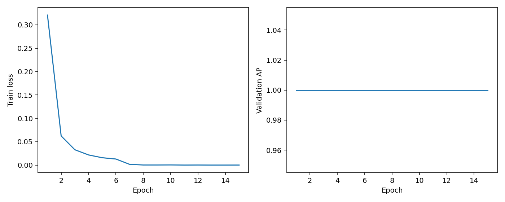
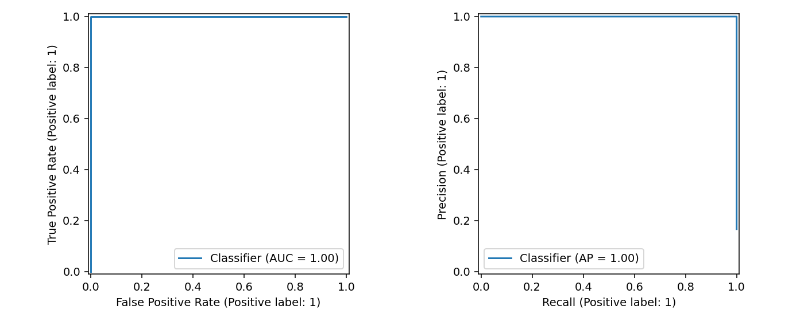

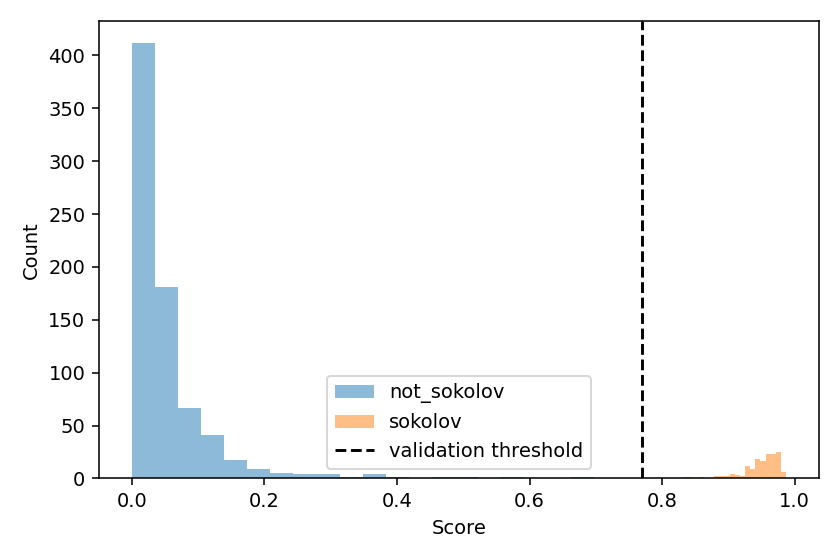

Примеры ошибок (полный список и исходные пути — в локальном errors.csv):

| ID | Истинная метка | Оценка | Тип |
|---|---|---|---|

## arcface

```json
{
  "training_seconds": 221.5297107080114,
  "parameters": 43591361,
  "checkpoint_bytes": 174695850,
  "benchmark": {
    "device": "mps",
    "batch_size": 32,
    "warmup_batches": 5,
    "measured_batches": 20,
    "images_per_second": 144.44237643383207,
    "milliseconds_per_image": 6.923176042164414,
    "scope": "classifier forward only; excludes detection, decoding and transfer"
  },
  "coverage": {
    "total": 900,
    "usable_faces": 894,
    "fraction": 0.9933333333333333,
    "no_face": 3,
    "multiple_faces": 3,
    "alignment_failed": 0
  },
  "pretrained_weights": {
    "source": "InsightFace arcface_torch iResNet50/MS1MV3",
    "sha256": "ef005ba502a2d0f40e7b94245054d3a23e375776f7035080fcbce45ae49cfb01"
  },
  "environment": {
    "source_sha256": "bde86420d1f4f1260f6e1f0deb7acace1dc1ae5751146c0ae783c5b187a04c54",
    "python": "3.12.15",
    "platform": "macOS-15.5-arm64-arm-64bit",
    "packages": {
      "torch": "2.5.1",
      "torchvision": "0.20.1",
      "numpy": "1.26.4",
      "scikit-learn": "1.6.1",
      "Pillow": "11.1.0",
      "ImageHash": "4.3.2",
      "matplotlib": "3.10.0",
      "insightface": "0.7.3",
      "onnxruntime": "1.20.1",
      "kagglehub": "0.3.12",
      "scipy": "1.15.2",
      "scikit-image": "0.25.2",
      "opencv-python-headless": "4.10.0.84",
      "Markdown": "3.7",
      "onnx": "1.17.0"
    },
    "git_commit": "d3e24f10a408e558d6926f644d69df358776dee6",
    "git_dirty": true,
    "device": "mps"
  },
  "threshold": {
    "threshold": 0.6874397397041321,
    "validation_f1": 0.9932885906040269,
    "selection_partition": "val",
    "tie_break": "largest_threshold",
    "checkpoint_sha256": "4c6b7d4a3dfc972f37504bc1397ad0457eac0ceeb1180f360d56280aaf6989ae"
  }
}
```

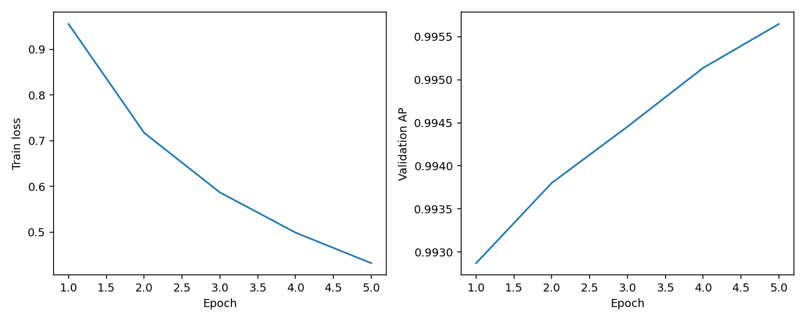
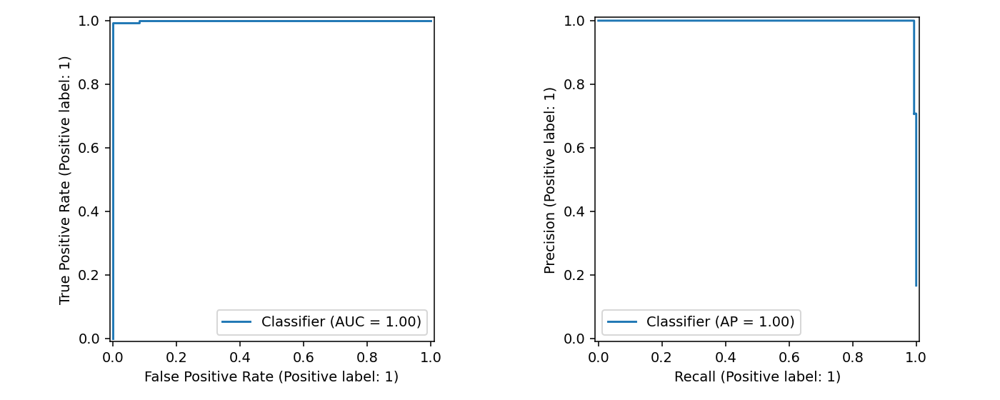
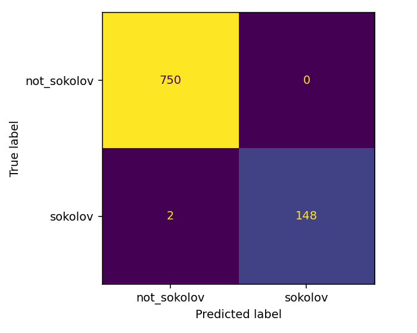
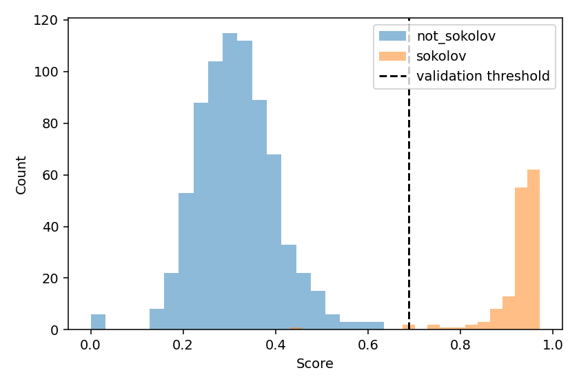

Примеры ошибок (полный список и исходные пути — в локальном errors.csv):

| ID | Истинная метка | Оценка | Тип |
|---|---|---|---|
| sokolov_01_0087 | 1 | 0.43136 | FN |
| sokolov_03_0033 | 1 | 0.68161 | FN |

## Лучшая сохранённая модель

Победитель: **resnet18**, validation AP=1.000000, эпоха 1.
Выбор выполнен по validation, без использования test. Полный checkpoint сохранён локально в best_model.pt.


## Генерация из случайного шума

Веса выбранной модели фиксированы. Adam изменяет только пиксели входной картинки.
Максимизируется логит «Соколов» с TV- и L2-регуляризацией. После каждого шага пиксели ограничены диапазоном [0,1].
Оценки на графике рассчитаны по сохранённым 8-битным пикселям. Детектор лиц в оптимизации не участвует.
Высокая оценка не гарантирует узнаваемое лицо. Показаны все начальные шумы; рост оценки не обязан быть монотонным.

```json
{
  "architecture": "resnet18",
  "checkpoint_sha256": "d669522521eb03e7cc4ae5c1539004d15869959db051c4e3da43d27f6667bacf",
  "generation": {
    "steps": 500,
    "lr": 0.05,
    "tv_weight": 0.0001,
    "l2_weight": 1e-05,
    "seeds": [
      0,
      1,
      2,
      3,
      4
    ],
    "snapshot_every": 25
  },
  "technical_test": false,
  "seeds": [
    0,
    1,
    2,
    3,
    4
  ],
  "selection_partition": "val",
  "results": [
    {
      "seed": 0,
      "initial_score": 0.013218062929809093,
      "final_score": 1.0,
      "final_logit": 96.38703155517578,
      "weights_unchanged": true,
      "first_input_gradient_norm": 1.9196820259094238
    },
    {
      "seed": 1,
      "initial_score": 0.0075304871425032616,
      "final_score": 1.0,
      "final_logit": 89.03382873535156,
      "weights_unchanged": true,
      "first_input_gradient_norm": 2.3589835166931152
    },
    {
      "seed": 2,
      "initial_score": 0.013607573695480824,
      "final_score": 1.0,
      "final_logit": 92.59385681152344,
      "weights_unchanged": true,
      "first_input_gradient_norm": 1.768424153327942
    },
    {
      "seed": 3,
      "initial_score": 0.01271912083029747,
      "final_score": 1.0,
      "final_logit": 93.64606475830078,
      "weights_unchanged": true,
      "first_input_gradient_norm": 2.324218273162842
    },
    {
      "seed": 4,
      "initial_score": 0.01211355347186327,
      "final_score": 1.0,
      "final_logit": 92.78678131103516,
      "weights_unchanged": true,
      "first_input_gradient_norm": 2.1277709007263184
    }
  ],
  "interpretation": "High classifier score does not guarantee a recognizable face; all seeds are shown."
}
```

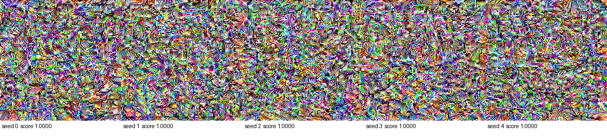
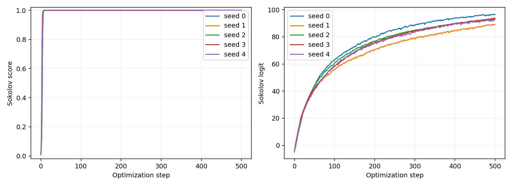

### Начальный шум 0

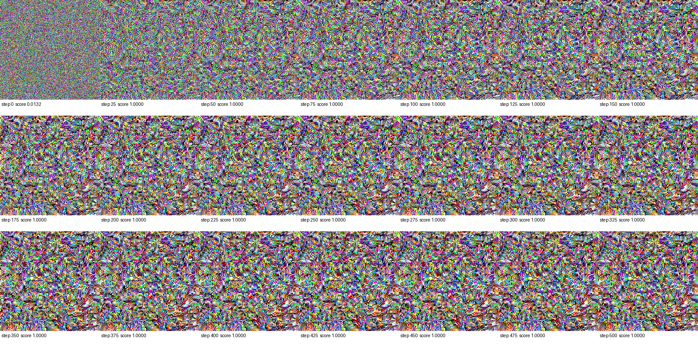


### Начальный шум 1

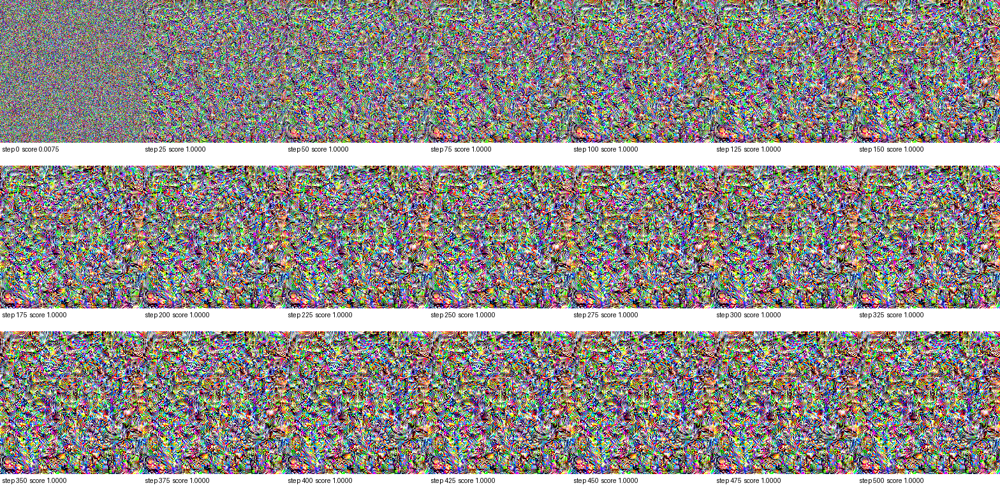


### Начальный шум 2

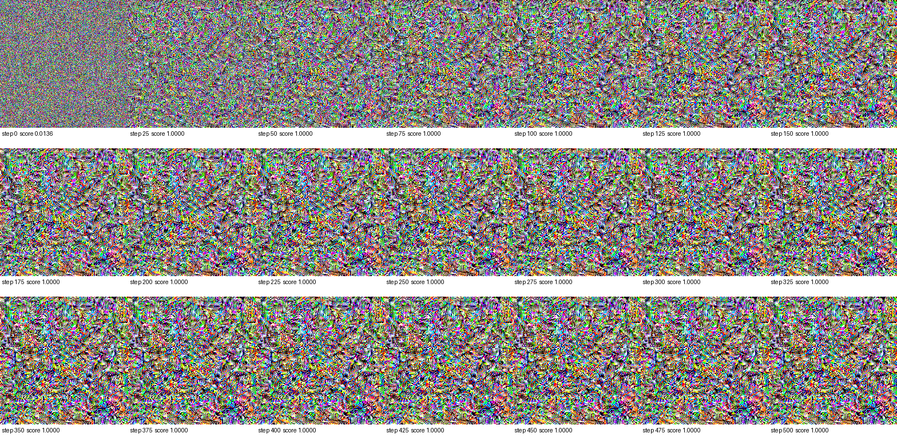


### Начальный шум 3

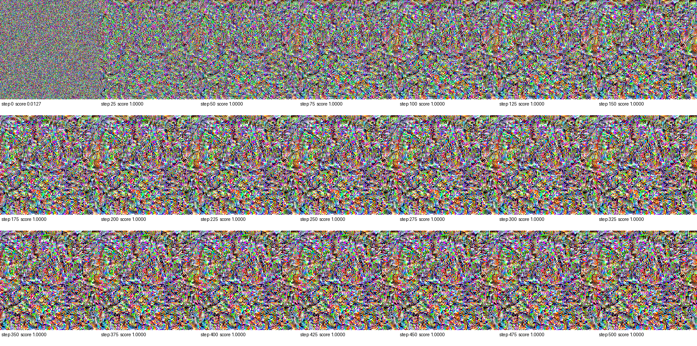


### Начальный шум 4

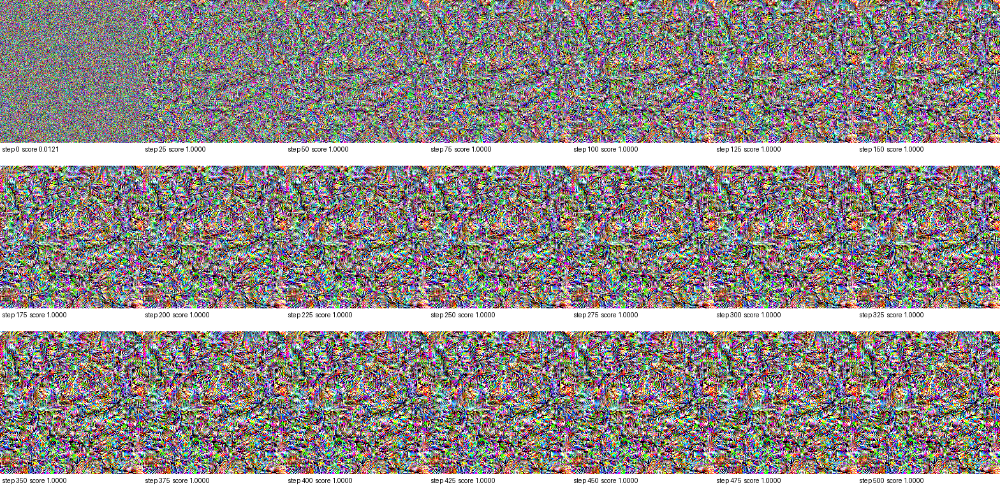


## Воспроизводимость

FairFace: https://github.com/joojs/fairface (CC BY 4.0).
Параметры, состояния обучения, исходные предсказания и аудит сохранены в файлах запуска.
Веса InsightFace предназначены для некоммерческих исследований.
