# Соколов / не Соколов — сравнение моделей

Результаты полного обучения на предобученных моделях.

Метки: 1 — Соколов, 0 — не Соколов. Пороги выбраны только на validation.

## Ограничения

- FairFace identity-disjoint splits are not guaranteed.
- Positive and negative classes come from different sources; domain shortcuts are possible.

## Данные

```json
{
  "train": {
    "originals": 2281,
    "usable": 2259,
    "labels_original": {
      "1": 519,
      "0": 1762
    },
    "labels_usable": {
      "1": 516,
      "0": 1743
    },
    "statuses": {
      "ok": 2259,
      "no_face": 5,
      "multiple_faces": 17
    },
    "coverage_by_label": {
      "1": 0.9942196531791907,
      "0": 0.9892167990919409
    },
    "web_by_label": {},
    "web_groups_by_label": {
      "0": 0,
      "1": 0
    }
  },
  "val": {
    "originals": 628,
    "usable": 625,
    "labels_original": {
      "1": 250,
      "0": 378
    },
    "labels_usable": {
      "1": 250,
      "0": 375
    },
    "statuses": {
      "ok": 625,
      "no_face": 1,
      "multiple_faces": 2
    },
    "coverage_by_label": {
      "1": 1.0,
      "0": 0.9920634920634921
    },
    "web_by_label": {},
    "web_groups_by_label": {
      "0": 0,
      "1": 0
    }
  },
  "test": {
    "originals": 630,
    "usable": 628,
    "labels_original": {
      "1": 250,
      "0": 380
    },
    "labels_usable": {
      "1": 250,
      "0": 378
    },
    "statuses": {
      "ok": 628,
      "multiple_faces": 1,
      "no_face": 1
    },
    "coverage_by_label": {
      "1": 1.0,
      "0": 0.9947368421052631
    },
    "web_by_label": {},
    "web_groups_by_label": {
      "0": 0,
      "1": 0
    }
  }
}
```

Исключено на аудите: 0. Кандидатов pHash: 6296.
Время детекции: 700.63 с. Детектор: SCRFD/det_10g.onnx.

## Метрики

| Модель | Уровень | Метрика | Значение |
|---|---|---|---|
| resnet18 | image_level | accuracy | 1 |
| resnet18 | image_level | balanced_accuracy | 1 |
| resnet18 | image_level | macro_f1 | 1 |
| resnet18 | image_level | mcc | 1 |
| resnet18 | image_level | specificity | 1 |
| resnet18 | image_level | roc_auc | 1 |
| resnet18 | image_level | average_precision | 1 |
| resnet18 | image_level | log_loss | 0.00736992 |
| resnet18 | image_level | brier_score | 0.00255367 |
| resnet18 | image_level | not_sokolov.precision | 1 |
| resnet18 | image_level | not_sokolov.recall | 1 |
| resnet18 | image_level | not_sokolov.f1 | 1 |
| resnet18 | image_level | not_sokolov.support | 380 |
| resnet18 | image_level | sokolov.precision | 1 |
| resnet18 | image_level | sokolov.recall | 1 |
| resnet18 | image_level | sokolov.f1 | 1 |
| resnet18 | image_level | sokolov.support | 250 |
| resnet18 | face_level | accuracy | 1 |
| resnet18 | face_level | balanced_accuracy | 1 |
| resnet18 | face_level | macro_f1 | 1 |
| resnet18 | face_level | mcc | 1 |
| resnet18 | face_level | specificity | 1 |
| resnet18 | face_level | roc_auc | 1 |
| resnet18 | face_level | average_precision | 1 |
| resnet18 | face_level | log_loss | 0.00739339 |
| resnet18 | face_level | brier_score | 0.00256181 |
| resnet18 | face_level | not_sokolov.precision | 1 |
| resnet18 | face_level | not_sokolov.recall | 1 |
| resnet18 | face_level | not_sokolov.f1 | 1 |
| resnet18 | face_level | not_sokolov.support | 378 |
| resnet18 | face_level | sokolov.precision | 1 |
| resnet18 | face_level | sokolov.recall | 1 |
| resnet18 | face_level | sokolov.f1 | 1 |
| resnet18 | face_level | sokolov.support | 250 |
| resnet18 | positive_domain_lecture | accuracy | 1 |
| resnet18 | positive_domain_lecture | balanced_accuracy | 1 |
| resnet18 | positive_domain_lecture | macro_f1 | 1 |
| resnet18 | positive_domain_lecture | mcc | 1 |
| resnet18 | positive_domain_lecture | specificity | 1 |
| resnet18 | positive_domain_lecture | roc_auc | 1 |
| resnet18 | positive_domain_lecture | average_precision | 1 |
| resnet18 | positive_domain_lecture | log_loss | 0.00736992 |
| resnet18 | positive_domain_lecture | brier_score | 0.00255367 |
| resnet18 | positive_domain_lecture | not_sokolov.precision | 1 |
| resnet18 | positive_domain_lecture | not_sokolov.recall | 1 |
| resnet18 | positive_domain_lecture | not_sokolov.f1 | 1 |
| resnet18 | positive_domain_lecture | not_sokolov.support | 380 |
| resnet18 | positive_domain_lecture | sokolov.precision | 1 |
| resnet18 | positive_domain_lecture | sokolov.recall | 1 |
| resnet18 | positive_domain_lecture | sokolov.f1 | 1 |
| resnet18 | positive_domain_lecture | sokolov.support | 250 |
| arcface | image_level | accuracy | 0.968254 |
| arcface | image_level | balanced_accuracy | 0.963421 |
| arcface | image_level | macro_f1 | 0.966605 |
| arcface | image_level | mcc | 0.933748 |
| arcface | image_level | specificity | 0.986842 |
| arcface | image_level | roc_auc | 0.994189 |
| arcface | image_level | average_precision | 0.993369 |
| arcface | image_level | log_loss | 0.625354 |
| arcface | image_level | brier_score | 0.216892 |
| arcface | image_level | not_sokolov.precision | 0.961538 |
| arcface | image_level | not_sokolov.recall | 0.986842 |
| arcface | image_level | not_sokolov.f1 | 0.974026 |
| arcface | image_level | not_sokolov.support | 380 |
| arcface | image_level | sokolov.precision | 0.979167 |
| arcface | image_level | sokolov.recall | 0.94 |
| arcface | image_level | sokolov.f1 | 0.959184 |
| arcface | image_level | sokolov.support | 250 |
| arcface | face_level | accuracy | 0.968153 |
| arcface | face_level | balanced_accuracy | 0.963386 |
| arcface | face_level | macro_f1 | 0.966537 |
| arcface | face_level | mcc | 0.933614 |
| arcface | face_level | specificity | 0.986772 |
| arcface | face_level | roc_auc | 0.994159 |
| arcface | face_level | average_precision | 0.993369 |
| arcface | face_level | log_loss | 0.627345 |
| arcface | face_level | brier_score | 0.217583 |
| arcface | face_level | not_sokolov.precision | 0.96134 |
| arcface | face_level | not_sokolov.recall | 0.986772 |
| arcface | face_level | not_sokolov.f1 | 0.97389 |
| arcface | face_level | not_sokolov.support | 378 |
| arcface | face_level | sokolov.precision | 0.979167 |
| arcface | face_level | sokolov.recall | 0.94 |
| arcface | face_level | sokolov.f1 | 0.959184 |
| arcface | face_level | sokolov.support | 250 |
| arcface | positive_domain_lecture | accuracy | 0.968254 |
| arcface | positive_domain_lecture | balanced_accuracy | 0.963421 |
| arcface | positive_domain_lecture | macro_f1 | 0.966605 |
| arcface | positive_domain_lecture | mcc | 0.933748 |
| arcface | positive_domain_lecture | specificity | 0.986842 |
| arcface | positive_domain_lecture | roc_auc | 0.994189 |
| arcface | positive_domain_lecture | average_precision | 0.993369 |
| arcface | positive_domain_lecture | log_loss | 0.625354 |
| arcface | positive_domain_lecture | brier_score | 0.216892 |
| arcface | positive_domain_lecture | not_sokolov.precision | 0.961538 |
| arcface | positive_domain_lecture | not_sokolov.recall | 0.986842 |
| arcface | positive_domain_lecture | not_sokolov.f1 | 0.974026 |
| arcface | positive_domain_lecture | not_sokolov.support | 380 |
| arcface | positive_domain_lecture | sokolov.precision | 0.979167 |
| arcface | positive_domain_lecture | sokolov.recall | 0.94 |
| arcface | positive_domain_lecture | sokolov.f1 | 0.959184 |
| arcface | positive_domain_lecture | sokolov.support | 250 |

Строки positive_domain_web и positive_domain_lecture сравнивают позитивы
одного домена с теми же общими test-негативами. При малом числе портретов
доменные оценки нестабильны. Число примеров указано в support.


## resnet18

```json
{
  "training_seconds": 332.3062662919983,
  "parameters": 11177025,
  "checkpoint_bytes": 111963520,
  "benchmark": {
    "device": "mps",
    "batch_size": 32,
    "warmup_batches": 5,
    "measured_batches": 20,
    "images_per_second": 562.9956384149184,
    "milliseconds_per_image": 1.7762126946763601,
    "scope": "classifier forward only; excludes detection, decoding and transfer"
  },
  "coverage": {
    "total": 630,
    "usable_faces": 628,
    "fraction": 0.9968253968253968,
    "no_face": 1,
    "multiple_faces": 1,
    "alignment_failed": 0
  },
  "pretrained_weights": {
    "source": "https://download.pytorch.org/models/resnet18-f37072fd.pth",
    "state_sha256": "2aead97338b5855cf4b9a3ae47ce15f4fc38b970f800ba309d50d4b7784ac0ee"
  },
  "selection_metric": "source_macro_ap",
  "environment": {
    "source_sha256": "2de26c5cce6eaa23931eff6ca7f88949104cbb23587a7d16f89dcef19c03b982",
    "python": "3.12.16",
    "platform": "macOS-26.1-arm64-arm-64bit",
    "packages": {
      "torch": "2.5.1",
      "torchvision": "0.20.1",
      "numpy": "1.26.4",
      "scikit-learn": "1.6.1",
      "Pillow": "11.1.0",
      "ImageHash": "4.3.2",
      "matplotlib": "3.10.0",
      "insightface": "0.7.3",
      "onnxruntime": "1.20.1",
      "kagglehub": "0.3.12",
      "scipy": "1.15.2",
      "scikit-image": "0.25.2",
      "opencv-python-headless": "4.10.0.84",
      "Markdown": "3.7",
      "onnx": "1.17.0"
    },
    "git_commit": "dc4ab44987d18f6d5d58bf4836ee051279045f0f",
    "git_dirty": true,
    "device": "mps"
  },
  "threshold": {
    "threshold": 0.9182406067848206,
    "validation_f1": 0.9979959919839679,
    "selection_partition": "val",
    "tie_break": "largest_threshold",
    "weighting": "equal_domains_and_sources_within_class",
    "checkpoint_sha256": "0c9e51f88c0f5c8e9b4a64125dd039e6dbdc49fe584c23aad40e13ac9f4f2faf"
  }
}
```

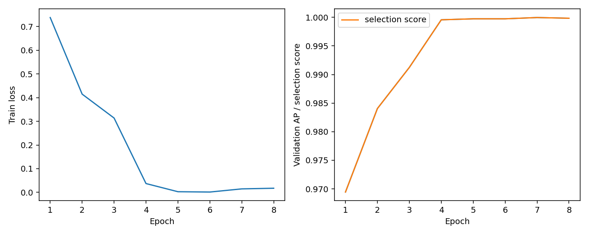
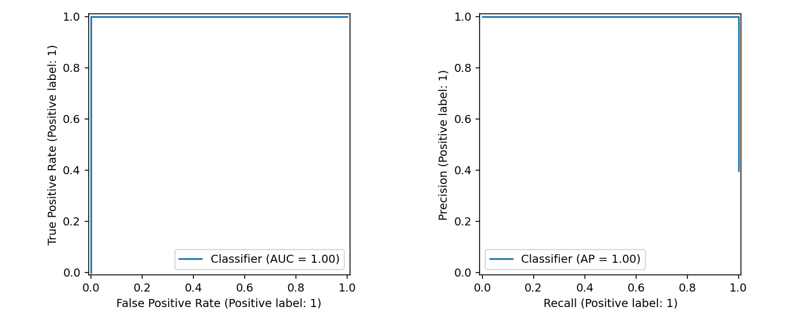
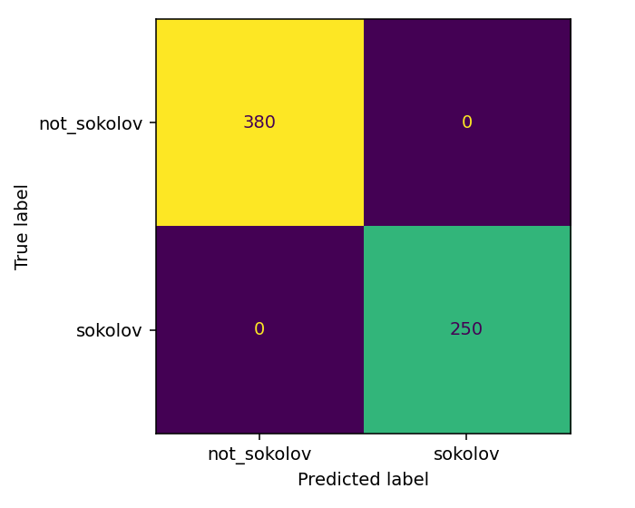
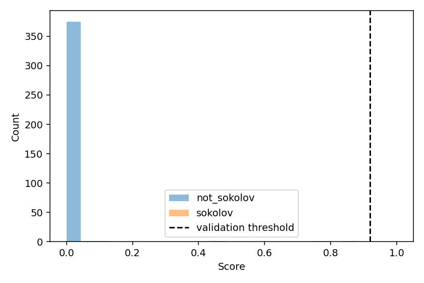

Примеры ошибок (полный список и исходные пути — в локальном errors.csv):

| ID | Истинная метка | Оценка | Тип |
|---|---|---|---|

## arcface

```json
{
  "training_seconds": 222.4798119161278,
  "parameters": 43591361,
  "checkpoint_bytes": 174669874,
  "benchmark": {
    "device": "mps",
    "batch_size": 32,
    "warmup_batches": 5,
    "measured_batches": 20,
    "images_per_second": 195.06800514876838,
    "milliseconds_per_image": 5.126417319115717,
    "scope": "classifier forward only; excludes detection, decoding and transfer"
  },
  "coverage": {
    "total": 630,
    "usable_faces": 628,
    "fraction": 0.9968253968253968,
    "no_face": 1,
    "multiple_faces": 1,
    "alignment_failed": 0
  },
  "pretrained_weights": {
    "source": "InsightFace arcface_torch iResNet50/MS1MV3",
    "sha256": "ef005ba502a2d0f40e7b94245054d3a23e375776f7035080fcbce45ae49cfb01"
  },
  "selection_metric": "source_macro_ap",
  "environment": {
    "source_sha256": "2de26c5cce6eaa23931eff6ca7f88949104cbb23587a7d16f89dcef19c03b982",
    "python": "3.12.16",
    "platform": "macOS-26.1-arm64-arm-64bit",
    "packages": {
      "torch": "2.5.1",
      "torchvision": "0.20.1",
      "numpy": "1.26.4",
      "scikit-learn": "1.6.1",
      "Pillow": "11.1.0",
      "ImageHash": "4.3.2",
      "matplotlib": "3.10.0",
      "insightface": "0.7.3",
      "onnxruntime": "1.20.1",
      "kagglehub": "0.3.12",
      "scipy": "1.15.2",
      "scikit-image": "0.25.2",
      "opencv-python-headless": "4.10.0.84",
      "Markdown": "3.7",
      "onnx": "1.17.0"
    },
    "git_commit": "dc4ab44987d18f6d5d58bf4836ee051279045f0f",
    "git_dirty": true,
    "device": "mps"
  },
  "threshold": {
    "threshold": 0.5477969646453857,
    "validation_f1": 0.9940119760479041,
    "selection_partition": "val",
    "tie_break": "largest_threshold",
    "weighting": "equal_domains_and_sources_within_class",
    "checkpoint_sha256": "4cddeef9c2ef10ea6a35c140ce093226fd9e407de5281bfb3dbd4a8f087faa7d"
  }
}
```

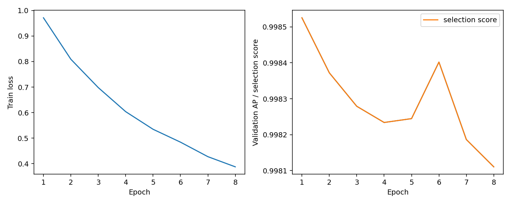
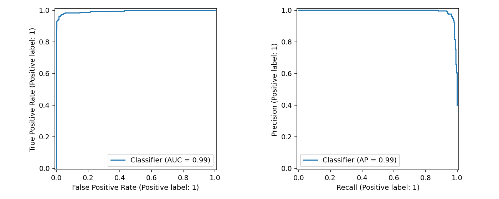
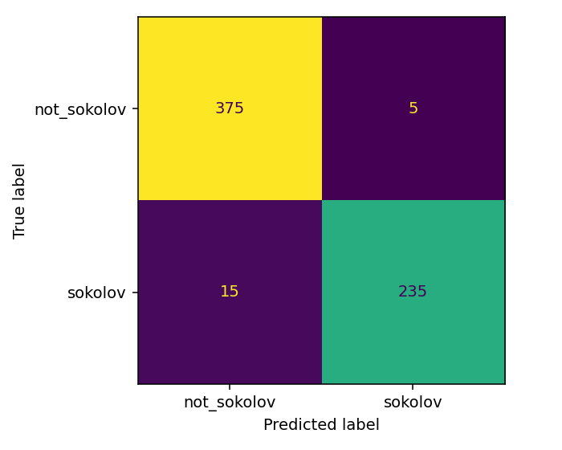
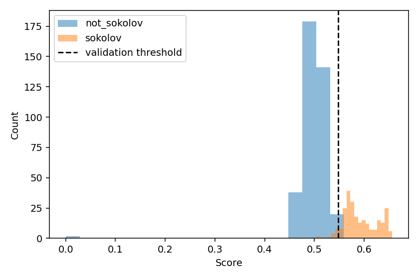

Примеры ошибок (полный список и исходные пути — в локальном errors.csv):

| ID | Истинная метка | Оценка | Тип |
|---|---|---|---|
| sokolov_04_0009 | 1 | 0.54742 | FN |
| sokolov_04_0100 | 1 | 0.53674 | FN |
| sokolov_04_0126 | 1 | 0.54779 | FN |
| sokolov_04_0137 | 1 | 0.53431 | FN |
| sokolov_04_0161 | 1 | 0.54561 | FN |
| sokolov_04_0194 | 1 | 0.53828 | FN |
| sokolov_04_0209 | 1 | 0.53963 | FN |
| sokolov_04_0210 | 1 | 0.53145 | FN |
| sokolov_04_0215 | 1 | 0.54609 | FN |
| sokolov_04_0221 | 1 | 0.54534 | FN |
| sokolov_04_0235 | 1 | 0.51935 | FN |
| sokolov_04_0237 | 1 | 0.54664 | FN |
| sokolov_04_0241 | 1 | 0.51422 | FN |
| sokolov_04_0245 | 1 | 0.50326 | FN |
| sokolov_04_0247 | 1 | 0.50763 | FN |
| fairface_f405185147588df150ef | 0 | 0.54824 | FP |
| fairface_17a2458d8779ad3d2ee2 | 0 | 0.55926 | FP |
| fairface_f5cc6aff5c8aebb3cc36 | 0 | 0.54918 | FP |
| fairface_6b80bff0d2395cf7f165 | 0 | 0.54850 | FP |
| fairface_1f31a70b78013041386e | 0 | 0.54884 | FP |

## Лучшая сохранённая модель

Победитель: **resnet18**, validation source_macro_ap=0.999968, эпоха 7.
Выбор выполнен по validation, без использования test. Полный checkpoint сохранён локально в best_model.pt.


## Генерация из случайного шума

Веса выбранной модели фиксированы. Adam изменяет только пиксели входной картинки.
Максимизируется логит «Соколов» с TV- и L2-регуляризацией. После каждого шага пиксели ограничены диапазоном [0,1].
Оценки на графике рассчитаны по сохранённым 8-битным пикселям. Детектор лиц в оптимизации не участвует.
Высокая оценка не гарантирует узнаваемое лицо. Показаны все начальные шумы; рост оценки не обязан быть монотонным.

```json
{
  "architecture": "resnet18",
  "checkpoint_sha256": "0c9e51f88c0f5c8e9b4a64125dd039e6dbdc49fe584c23aad40e13ac9f4f2faf",
  "generation": {
    "steps": 300,
    "lr": 0.05,
    "tv_weight": 0.0001,
    "l2_weight": 1e-05,
    "seeds": [
      0,
      1,
      2,
      3,
      4
    ],
    "snapshot_every": 25
  },
  "technical_test": false,
  "seeds": [
    0,
    1,
    2,
    3,
    4
  ],
  "selection_partition": "val",
  "results": [
    {
      "seed": 0,
      "initial_score": 0.5758411288261414,
      "final_score": 1.0,
      "final_logit": 102.28182220458984,
      "weights_unchanged": true,
      "first_input_gradient_norm": 5.448117256164551
    },
    {
      "seed": 1,
      "initial_score": 0.47168636322021484,
      "final_score": 1.0,
      "final_logit": 109.60814666748047,
      "weights_unchanged": true,
      "first_input_gradient_norm": 4.3551483154296875
    },
    {
      "seed": 2,
      "initial_score": 0.48430779576301575,
      "final_score": 1.0,
      "final_logit": 103.498779296875,
      "weights_unchanged": true,
      "first_input_gradient_norm": 4.819876194000244
    },
    {
      "seed": 3,
      "initial_score": 0.3050788342952728,
      "final_score": 1.0,
      "final_logit": 103.75833129882812,
      "weights_unchanged": true,
      "first_input_gradient_norm": 5.458966255187988
    },
    {
      "seed": 4,
      "initial_score": 0.452731192111969,
      "final_score": 1.0,
      "final_logit": 97.93004608154297,
      "weights_unchanged": true,
      "first_input_gradient_norm": 5.251269340515137
    }
  ],
  "interpretation": "High classifier score does not guarantee a recognizable face; all seeds are shown."
}
```

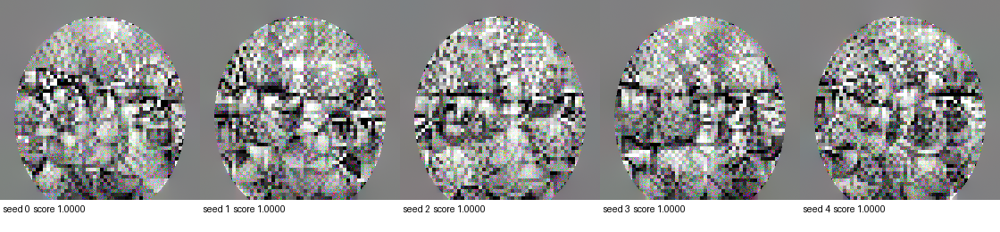
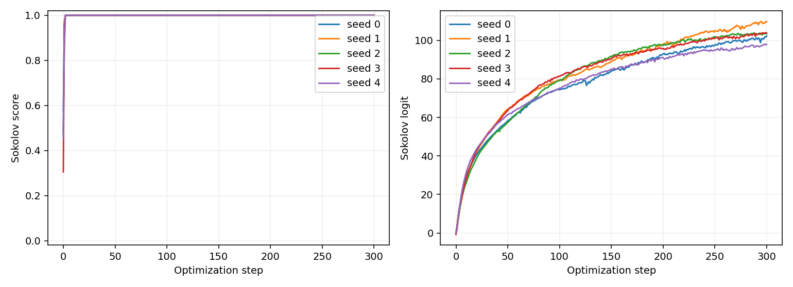

### Начальный шум 0

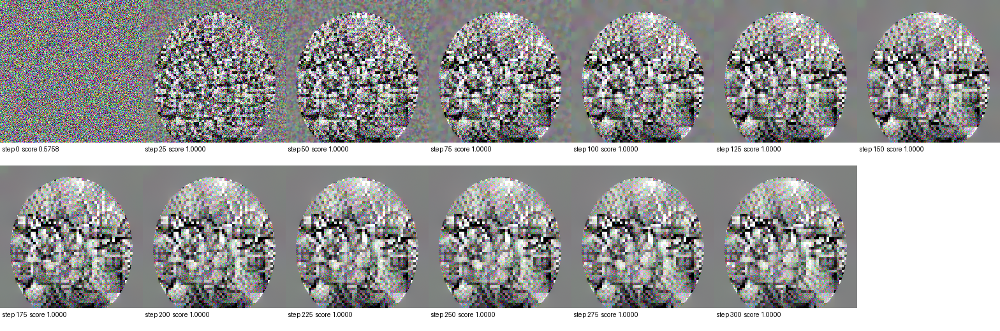


### Начальный шум 1

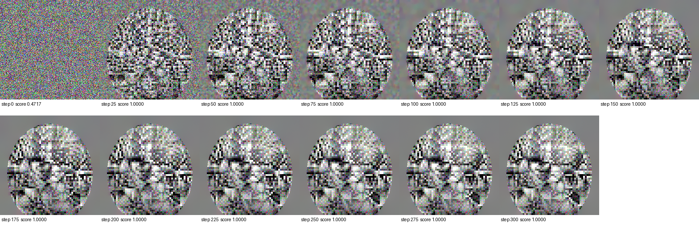


### Начальный шум 2

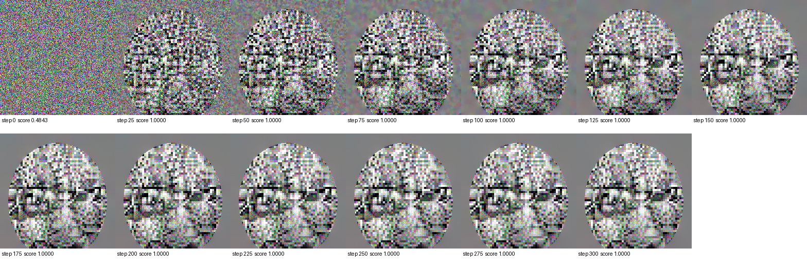


### Начальный шум 3

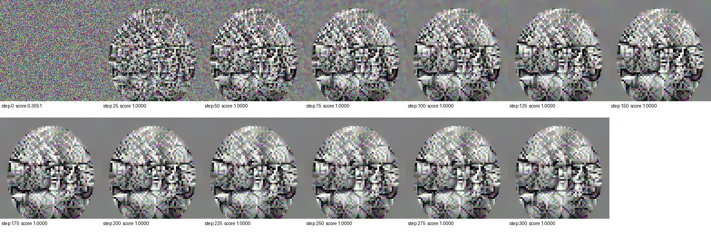


### Начальный шум 4

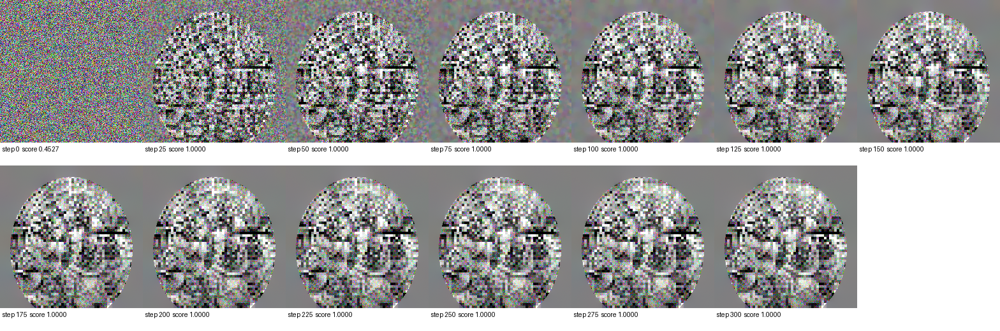


## Воспроизводимость

FairFace: https://github.com/joojs/fairface (CC BY 4.0).
Параметры, состояния обучения, исходные предсказания и аудит сохранены в файлах запуска.
Веса InsightFace предназначены для некоммерческих исследований.
